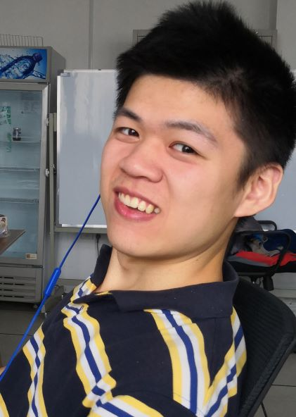

I received my Ph.D. from the Department of Computer Science at Tsinghua University, received my bachelor’s degree from the Department of Computer Science and Technology at Harbin Institute of Technology. My research interests include materialized views and machine learning for database.

I currently work at Huawei as a database engineer, responsible for the multi-threaded parallel execution framework of the database compute engine. Developed features including primary-standby parallel computing, shared-disk distributed query processing, distributed cache affinity, adaptive degree of parallelism of query, and thread resource management. Improved the scalability of multi-core parallel computing and strengthened the quality and robustness of the parallel execution module.

Welcome to My Blog [akaisora.tech](http://akaisora.tech/).  
My <a href="/assets/files/CV-yuehan-cn.pdf" target="_blank">Curriculum Vitae (CN)</a> <a href="/assets/files/CV-yuehan-en.pdf" target="_blank">(EN)</a>(2026.5 updated).

